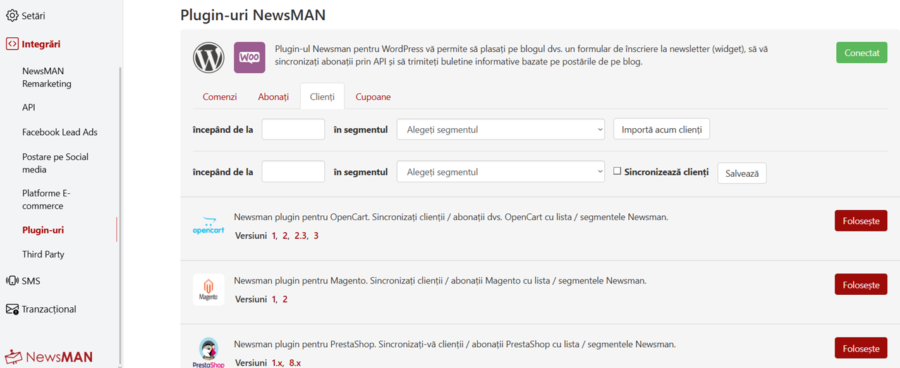
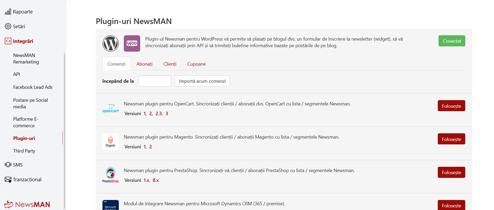
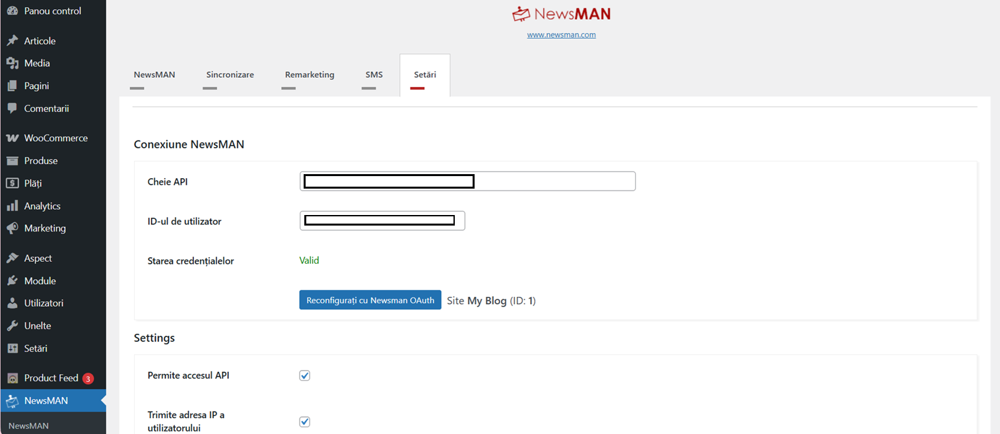
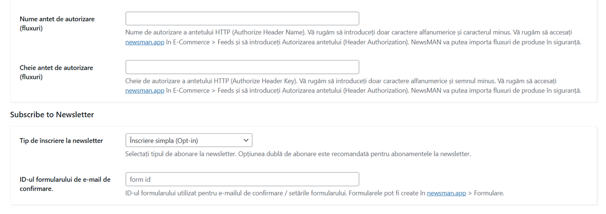
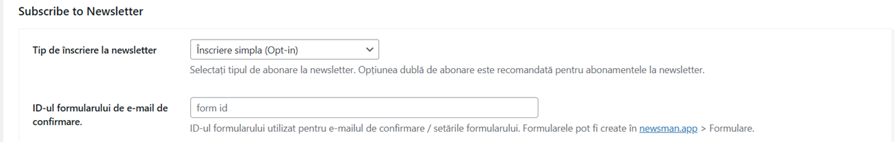
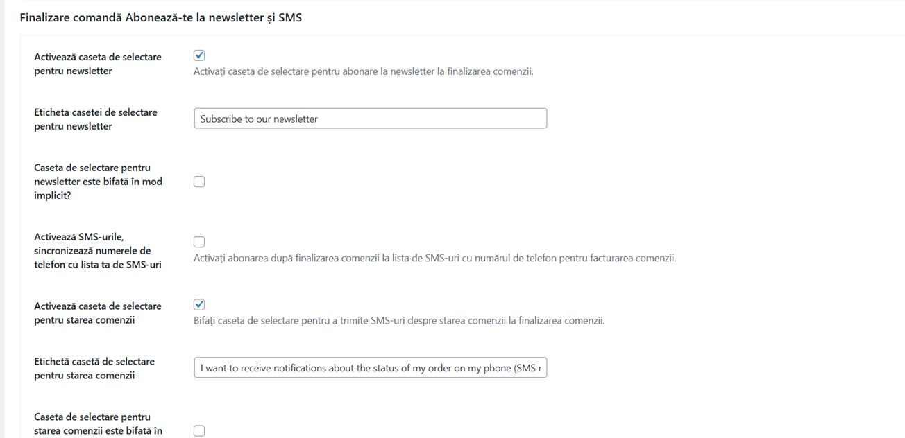

# Plugin Newsman pentru WordPress - Ghid de Configurare

Acest ghid prezinta toate setarile din plugin-ul Newsman, pentru a va putea conecta magazinul WordPress sau WooCommerce la contul Newsman si a incepe sa colectati abonati, sa trimiteti newslettere si sa urmariti comportamentul clientilor.

## Cuprins

- [Unde Gasiti Setarile Plugin-ului](#unde-gasiti-setarile-plugin-ului)
- [Primii Pasi - Conectarea la Newsman](#primii-pasi---conectarea-la-newsman)
- [Reconfigurare cu Newsman OAuth](#reconfigurare-cu-newsman-oauth)
- [Pagina NewsMAN (Stare)](#pagina-newsman-stare)
- [Pagina Settings](#pagina-settings)
- [Pagina Sync](#pagina-sync)
- [Pagina Remarketing](#pagina-remarketing)
- [Pagina SMS (doar WooCommerce)](#pagina-sms-doar-woocommerce)
- [Blocuri pentru formulare de abonare (editorul de blocuri)](#blocuri-pentru-formulare-de-abonare-editorul-de-blocuri)
- [Formulare Elementor (Elementor Pro)](#formulare-elementor-elementor-pro)
- [Atomic Forms (Elementor 4.x, experimental)](#atomic-forms-elementor-4x-experimental)
- [Contact Form 7](#contact-form-7)
- [WPForms](#wpforms)
- [Gravity Forms](#gravity-forms)
- [Export abonati din trimiteri de formulare](#export-abonati-din-trimiteri-de-formulare)
- [Date personale (GDPR)](#date-personale-gdpr)
- [Comenzi WP-CLI](#comenzi-wp-cli)
- [Intrebari Frecvente](#intrebari-frecvente)

---

## Unde Gasiti Setarile Plugin-ului

Dupa instalarea si activarea plugin-ului, cautati elementul de meniu **NewsMAN** in bara laterala din stanga a panoului de administrare WordPress. Facand click pe el, apar mai multe sub-pagini:

- **NewsMAN** - Pagina principala: versiunea plugin-ului, starea conexiunii, ultimele exporturi si linkuri catre documentatie
- **Sync** - Alegeti ce lista Newsman primeste abonatii
- **Remarketing** - Urmariti comportamentul vizitatorilor din magazin pentru campanii personalizate
- **SMS** - Trimiteti mesaje text clientilor cand se schimba statusul comenzii (disponibil doar daca folositi WooCommerce)
- **Settings** - Conexiunea API, optiuni checkout si setari avansate
- **OAuth** - Configurare rapida prin conectarea directa la contul Newsman

---

## Primii Pasi - Conectarea la Newsman

Inainte de a putea folosi orice functionalitate, trebuie sa conectati plugin-ul la contul dvs. Newsman. Exista doua modalitati:

### Optiunea A: Configurare Rapida cu OAuth (Recomandat)

1. Accesati **NewsMAN > OAuth** in panoul de administrare WordPress.
2. Faceti click pe **Connect with Newsman**.
3. Veti fi redirectionat catre site-ul Newsman. Autentificati-va daca este necesar si acordati acces:




4. Veti fi redirectionat inapoi catre o pagina de administrare Newsman in WordPress, unde alegeti lista de email dintr-un dropdown. Selectati lista pe care doriti sa o folositi si faceti click pe **Save**.
5. Asta e tot - API Key, User ID si Lista sunt toate configurate.

### Optiunea B: Configurare Manuala

1. Autentificati-va in contul Newsman pe newsman.app.
2. Accesati setarile contului si copiati **API Key** si **User ID**.
3. In WordPress, accesati **NewsMAN > Settings**.
4. Inserati **API Key** si **User ID** in campurile corespunzatoare.
5. Faceti click pe **Save**. Un indicator verde va confirma ca conexiunea a fost realizata cu succes.
6. Acum accesati **NewsMAN > Sync**. Deoarece ati introdus un API Key si User ID valide, dropdown-ul **Select a list** va afisa acum toate listele din contul dvs. Newsman. Alegeti lista pe care doriti sa o folositi si faceti click pe **Save** din nou.

---

## Reconfigurare cu Newsman OAuth

Daca trebuie sa reconectati plugin-ul la un alt cont Newsman, sau daca credentialele s-au schimbat, accesati **NewsMAN** sau **NewsMAN > Settings** si faceti click pe butonul **Reconfigure with Newsman OAuth**. Acest lucru va va ghida prin acelasi flux OAuth descris mai sus - veti fi redirectionat catre site-ul Newsman pentru a autoriza accesul, apoi inapoi in WordPress pentru a selecta lista de email. API Key, User ID si Lista vor fi actualizate cu noile credentiale.

---

## Pagina NewsMAN (Stare)

Pagina principala **NewsMAN** arata versiunea plugin-ului, butonul **Reconfigure with Newsman OAuth** cu numele si ID-ul site-ului curent, o sectiune **Stare** (Status), shortcode-ul pentru widget-ul formularului de abonare NewsMAN si linkuri catre acest ghid.

Sectiunea **Stare** verifica plugin-ul de fiecare data cand deschideti pagina. Fiecare rand are o stare colorata: verde inseamna ca functioneaza, portocaliu necesita atentie, rosu este o problema, iar albastru este informativ. Un link sub rand deschide pagina unde puteti rezolva problema.

| Rand | Ce arata |
|------|----------|
| **API credentials** | Daca NewsMAN accepta API Key si User ID salvate. Plugin-ul interogheaza API-ul NewsMAN cand se deschide pagina. |
| **Email list** | Numele si ID-ul listei selectate, plus un avertisment daca lista a fost stearsa din contul NewsMAN. |
| **Allow API access** | Daca NewsMAN poate citi abonatii, clientii, produsele si comenzile de pe site (optiunea **Allow API access** din Settings). |
| **Remarketing** | Daca scriptul de urmarire este pornit si are un Remarketing ID. Cand este, randul are un buton de verificare a magazinului, vezi mai jos. |
| **Action Scheduler** | Cate sarcini NewsMAN din fundal sunt in asteptare, intarziate (asteapta de peste o ora) sau au esuat in ultimele 7 zile. Sarcinile intarziate inseamna de obicei ca WP-Cron nu ruleaza. Linkul deschide **Tools > Scheduled Actions** filtrat pe sarcinile NewsMAN. |
| **WooCommerce** | Daca WooCommerce este activ si versiunea lui. |
| **Last exports** | Cand a citit NewsMAN ultima data fiecare tip de date: abonati, iar cu WooCommerce si clienti, produse si comenzi. Plugin-ul incepe sa inregistreze aceste date dupa actualizare, deci un tip arata "No export recorded yet" pana cand NewsMAN il citeste din nou. |

### Verificarea scripturilor de remarketing din magazin

Cand remarketing este pornit, randul **Remarketing** are un buton **Check the remarketing scripts on the storefront**. Acesta descarca in fundal trei pagini din magazin si cauta scripturile NewsMAN in fiecare:

| Pagina | Ce cauta |
|--------|----------|
| Pagina principala | Scriptul de urmarire NewsMAN si evenimentul de vizualizare a paginii. |
| Pagina de produs (cel mai nou produs publicat) | Scriptul de urmarire si evenimentul de vizualizare a produsului. |
| Pagina de categorie (categoria cu cele mai multe produse) | Scriptul de urmarire si evenimentul listei de produse. |

Paginile de produs si de categorie se verifica doar cu WooCommerce. Paginile de cos, checkout si confirmare a comenzii nu sunt verificate.

Administratorii nu primesc niciodata scripturile de remarketing in magazin, ca vizitele lor sa nu fie urmarite. De aceea butonul adauga un cod de unica folosinta la adresele paginilor. Codul functioneaza doar pentru administratorul care a apasat butonul, timp de 10 minute, pana la urmatoarea apasare. Paginile deschise cu acest cod nu sunt salvate de cache-ul de pagini. Scripturile sunt doar cautate in sursa paginii, nu sunt rulate, deci verificarea nu trimite nimic catre NewsMAN.

Daca un script nu este gasit, un cache de pagini poate servi o pagina mai veche, un plugin de optimizare a scripturilor le poate muta sau combina, sau tema nu foloseste hook-urile standard WooCommerce.

Aceasta verificare doar cauta scripturile in sursa paginii, ceea ce nu este suficient pentru a confirma ca urmarirea functioneaza. Cand este nevoie, verificati instalarea din contul NewsMAN: **newsman.app > Integrations > NewsMAN Remarketing >** butonul **Check installation**.

### Site Health

Aceleasi verificari apar si in **Tools > Site Health**:

- Tab-ul **Status** listeaza testele NewsMAN: conexiunea (API credentials si lista), accesul API, sarcinile din fundal (doar cand Action Scheduler este instalat) si remarketing (doar cand remarketing este pornit). Testul de conexiune ruleaza dupa incarcarea paginii, pentru ca interogheaza API-ul NewsMAN.
- Tab-ul **Info** are o sectiune **NewsMAN** cu versiunea plugin-ului, ID-ul listei, setarile, numarul de sarcini din fundal si ultimele exporturi. API Key nu este afisata niciodata. Folositi **Copy site info to clipboard** cand contactati suportul NewsMAN.

---

## Pagina Settings

Accesati **NewsMAN > Settings** pentru a configura comportamentul plugin-ului.

### Setari Generale


- **Allow API access** - Activati aceasta optiune daca doriti ca Newsman sa poata prelua date (precum produse sau abonati) direct din magazinul dvs. Aceasta este necesara pentru functionalitati precum feed-urile de produse in newslettere. Lasati-o dezactivata daca nu aveti nevoie de ea.



- **Send User IP Address** - Cand un vizitator se aboneaza, plugin-ul poate trimite adresa IP a acestuia catre Newsman. Acest lucru poate ajuta la analiza si conformitate. Daca dezactivati aceasta optiune, plugin-ul va folosi in schimb **Server IP Address** pe care il introduceti mai jos.

- **Server IP Address** - O adresa IP de rezerva folosita cand "Send User IP Address" este dezactivata. De obicei puteti lasa acest camp gol.

- **Import Authorize Header Name / Key** - Aceasta este o optiune veche (legacy) pentru protejarea feed-ului de produse cu credentiale de securitate personalizate. Daca v-ati conectat prin OAuth, nu trebuie sa le setati - plugin-ul gestioneaza autentificarea automat. Trebuie sa le completati doar daca ati configurat conexiunea manual si doriti sa adaugati un nivel suplimentar de securitate la importurile de feed-uri de produse.

### Abonare la Newsletter



- **Newsletter Opt-in type** - Alegeti cum sunt adaugati noii abonati:
  - **Opt-in** - Abonatul este adaugat imediat.
  - **Double Opt-in** - Abonatul primeste mai intai un email de confirmare si trebuie sa faca click pe un link pentru a confirma. Aceasta optiune este recomandata pentru conformitatea GDPR.

- **Confirmation email Form ID** - Daca ati ales Double Opt-in mai sus, introduceti Form ID-ul din contul dvs. Newsman. Acesta spune Newsman ce sablon de email de confirmare sa trimita. Puteti gasi acest ID in dashboard-ul Newsman la sectiunea Forms. Este folosit de bifa din checkout, de pagina de newsletter din Contul Meu, de blocul **NewsMAN Subscribe Form** si de formularele din integrari marcate ca **Newsletter form** (un bloc sau un formular isi poate seta propriul ID). Folositi doar un ID care exista in contul dvs. Newsman: Newsman respinge o abonare cu un form ID necunoscut, deci nu se trimite niciun email de confirmare.

### Optiuni Checkout (doar WooCommerce)

Aceste setari adauga un checkbox de newsletter pe pagina de checkout a magazinului, astfel incat clientii se pot abona in timp ce plaseaza o comanda.



- **Enable Newsletter Checkbox** - Activati pentru a afisa un checkbox "Aboneaza-te la newsletter" pe pagina de checkout.

- **Newsletter Checkbox Label** - Personalizati textul afisat langa checkbox. De exemplu: "Da, doresc sa primesc oferte speciale si noutati prin email."

- **Checkbox checked by default** - Daca este activat, checkbox-ul va fi pre-bifat. Clientii vor trebui sa il debifeze daca nu doresc sa se aboneze. Nota: in unele regiuni, pre-bifarea poate sa nu fie conforma cu reglementarile de confidentialitate.

- **Enable SMS sync** - Cand un client plaseaza o comanda, numarul sau de telefon va fi sincronizat cu lista SMS Newsman. Aceasta va permite sa le trimiteti mesaje text ulterior.

- **Enable Order Status Checkbox** - Afiseaza un checkbox suplimentar care intreaba clientii daca doresc sa primeasca actualizari SMS despre statusul comenzii (de ex., "Comanda dvs. a fost expediata").

- **Order Status Checkbox Label** - Personalizati textul pentru checkbox-ul de status al comenzii.

- **Order Status checkbox checked by default** - Daca checkbox-ul de status al comenzii este pre-bifat.

### Newsletter in Contul Meu (doar WooCommerce)

Aceste setari adauga o pagina dedicata de newsletter in zona "Contul Meu" a clientului, unde isi pot gestiona abonarea.

- **Enable** - Activati pentru a adauga pagina de newsletter in Contul Meu.

- **Page Menu Label** - Textul afisat in meniul lateral al Contului Meu (de ex., "Newsletter").

- **Page Title** - Titlul afisat pe pagina de newsletter (de ex., "Abonare Newsletter").

- **Checkbox Label** - Textul de langa checkbox-ul de abonare/dezabonare (de ex., "Doresc sa primesc newslettere si promotii").

### Setari pentru Dezvoltatori

Aceste setari sunt destinate utilizatorilor avansati si dezvoltatorilor. In cele mai multe cazuri, ar trebui sa le lasati la valorile implicite.

- **Logging level** - Controleaza cat de mult detaliu scrie plugin-ul in fisierul de log. Valoarea implicita este **Error**, care inregistreaza doar problemele. Setati la **Debug** daca investigati o problema (dar nu uitati sa il setati inapoi dupa aceea, deoarece modul Debug creeaza fisiere de log mari). Setati la **No Logging** pentru a dezactiva complet logarea. Cu WooCommerce logul este in **WooCommerce > Status > Logs** (sursa `newsman`); fara WooCommerce este scris in logul de erori PHP (vezi [Unde sunt logurile plugin-ului?](#unde-sunt-logurile-plugin-ului)).

- **API Timeout** - Cate secunde asteapta plugin-ul un raspuns de la Newsman inainte de a renunta. Valoarea implicita de 10 secunde functioneaza bine pentru majoritatea configuratiilor. Mariti-o doar daca intampinati erori de timeout pe un server lent.

- **Enable Test User IP / Test User IP address** - Doar pentru dezvoltare si testare. Va permite sa simulati o adresa IP specifica de vizitator. Lasati-le dezactivate in productie.

- **Use Elementor Integration** - Comutator principal pentru integrarea Newsman cu Elementor Pro. **Activat implicit.** Cand este activat, sectiunea Newsman apare in editorul Elementor atat pentru widget-ul Form clasic, cat si pentru Atomic Forms (Elementor 4.x), iar trimiterile sunt impinse catre lista Newsman. Dezactivati pentru a elimina toate controalele Newsman din editor si pentru a opri redirectionarea trimiterilor pentru ambele. Setarile Newsman per formular / per camp existente sunt pastrate cand este dezactivat si reactivate cand il porniti din nou. Dezactivarea nu are efect asupra fluxurilor de newsletter WordPress, WooCommerce sau non-Elementor.

- **Use Contact Form 7 Integration** - Comutator principal pentru integrarea Newsman cu Contact Form 7. **Activat implicit.** Vizibil doar cand plugin-ul Contact Form 7 este instalat. Cand este activat, un tab Newsman apare in ecranul de editare al fiecarui formular de contact (selectie lista per formular, camp de email, proprietati), iar trimiterile sunt impinse catre lista Newsman. Dezactivati pentru a elimina tab-ul din editor si a opri redirectionarea trimiterilor. Setarile Newsman per formular existente sunt pastrate cand este dezactivat si reactivate cand il porniti din nou. Dezactivarea nu are efect asupra fluxurilor de newsletter WordPress, WooCommerce, Elementor sau alte integrari.

- **Use WPForms Integration** - Comutator principal pentru integrarea Newsman cu WPForms (Lite sau Pro). **Activat implicit.** Vizibil doar cand WPForms este instalat. Cand este activat, o sectiune Newsman apare in panoul Settings al fiecarui formular din builder-ul WPForms (selectie lista per formular, camp de email, proprietati), iar trimiterile sunt impinse catre lista Newsman. Dezactivati pentru a elimina sectiunea din builder si a opri redirectionarea trimiterilor. Setarile Newsman per formular existente sunt pastrate cand este dezactivat si reactivate cand il porniti din nou. Dezactivarea nu are efect asupra fluxurilor de newsletter WordPress, WooCommerce, Elementor, Contact Form 7 sau alte integrari.

- **Plugin Loaded Priority** - Controleaza cand se initializeaza plugin-ul in raport cu alte plugin-uri. Schimbati doar daca intampinati conflicte cu alt plugin. Valoarea implicita de 20 functioneaza pentru majoritatea configuratiilor.

- **Use Action Scheduler** - Daca aveti plugin-ul Action Scheduler instalat, activarea acestuia va procesa abonarile si dezabonarile in fundal in loc de imediat. Aceasta poate imbunatati viteza checkout-ului pe magazinele cu trafic mare.

- **Use Action Scheduler for Subscribe / Unsubscribe** - Control detaliat asupra operatiunilor care folosesc procesarea in fundal.

---

## Pagina Sync

Accesati **NewsMAN > Sync** pentru a alege unde sunt trimisi abonatii dvs. in Newsman.

- **Select a list** - Alegeti lista de email Newsman care va primi abonatii dvs. Toate listele din contul dvs. Newsman sunt afisate aici.

- **Select a segment** - Optional, alegeti un segment din lista selectata. Segmentele va permit sa organizati abonatii in grupuri (de ex., "Clienti VIP", "Cititori Blog"). Daca nu folositi segmente, lasati acest camp gol. Dropdown-ul este restrans la lista si se actualizeaza instant cand schimbati lista de mai sus — fara reincarcarea paginii — folosind harta de segmente pe lista din cache. Nu uitati sa apasati **Save Changes** pentru a aplica noua lista/segment.

- **Select an SMS list** - Alegeti lista SMS Newsman pentru sincronizarea numerelor de telefon.

### Refresh lists & segments cache

Langa butonul **Save Changes** de pe aceasta pagina exista un al doilea buton: **Refresh lists & segments cache**.

Integrarile de formulare (Elementor, Contact Form 7, WPForms, Gravity Forms) si pagina Sync memoreaza in cache datele din dropdown-urile din contul dvs. Newsman astfel incat deschiderea unei pagini admin sa nu apeleze API-ul Newsman de fiecare data. Cache-ul foloseste tranziente WordPress si se completeaza automat prima data cand un administrator viziteaza o pagina Newsman care are nevoie de aceste date. Sunt folosite trei tranziente separate:

- **Liste** — per-blog, indexate dupa User ID Newsman. **TTL 1 ora.**
- **Segmente** — per-blog, toate listele intr-o singura harta indexata dupa List ID Newsman. **TTL 1 ora.**
- **Liste SMS** — per-blog, indexate dupa User ID Newsman. **TTL 1 ora.**

Fiecare tranzient scrie si o copie persistenta de rezerva (un `wp_option` obisnuit, fara TTL). La un cache miss in care si apelul API live esueaza (eroare de retea, credentiale expirate), apelantii servesc ultima valoare cunoscuta-buna din rezerva in loc de un dropdown gol. Rezerva este suprascrisa silentios la fiecare reactualizare reusita, deci reflecta mereu ultimul raspuns reusit.

Deschiderea unui editor de formular (Elementor, CF7, WPForms, Gravity Forms) populeaza cache-ul de segmente pentru **toate** listele intr-un singur apel — endpoint-ul `segment.all` Newsman accepta `list_id=all` si returneaza toate segmentele din toate listele intr-un singur raspuns. Harta completa per-lista este apoi inclusa in pagina editorului, deci schimbarea dropdown-ului de lista comuta optiunile de segment in browser, fara un apel API suplimentar.

Apasand **Refresh lists & segments cache**:

- Pe o instalare WordPress simpla, reactualizeaza listele, segmentele si listele SMS pentru User ID-ul Newsman al site-ului curent.
- Pe o instalare WP Multisite (retea), itereaza toate site-urile din retea care au credentiale Newsman (User ID + API key) configurate si reactualizeaza toate cele trei cache-uri pentru fiecare.
- Foloseste aceeasi cheie API Newsman per-blog ca restul plugin-ului — nu exista credentiale partajate la nivel de retea.
- Face cel mult trei apeluri API Newsman pe blog: `list.all`, `segment.all?list_id=all`, `sms_list.all`.

Cand sa apasati: doar atunci cand ati facut modificari in contul dvs. Newsman (ati adaugat/sters liste sau segmente) si doriti ca acestea sa apara imediat in dropdown-urile editoarelor de formulare, in loc sa asteptati pana la 1 ora pentru expirarea naturala a cache-ului.

Daca un apel API Newsman esueaza in timpul reactualizarii (eroare retea, credentiale expirate), valoarea existenta din cache pentru acel blog este **pastrata** — reactualizarea este "best-effort". Pagina se intoarce cu o notificare care listeaza apelurile esuate, iar urmatoarea incarcare a paginii admin foloseste in continuare valorile cache-ului anterior pana cand intrarile esuate pot fi re-aduse. Stratul persistent de rezerva mentionat mai sus inseamna ca nici calea de citire nu returneaza vreodata un dropdown gol din cauza unui hop API tranzitoriu — serveste ultima valoare cunoscuta-buna cu o intrare de log discreta.

Fluxul OAuth (**NewsMAN > Settings - Reconfigure with Newsman OAuth**) ocoleste in intregime cache-ul astfel incat credentiale aflate in tranzit sa nu il poata polua.

Din linia de comanda, `wp newsman flush-cache` sterge listele, segmentele si listele SMS din cache pentru un site, fara sa apeleze API-ul Newsman; ele sunt citite din nou data viitoare cand este nevoie de ele, iar copia de rezerva ramane (vezi [Comenzi WP-CLI](#comenzi-wp-cli)).

---

## Pagina Remarketing

Accesati **NewsMAN > Remarketing** pentru a configura urmarirea vizitatorilor. Remarketing-ul permite Newsman sa urmareasca ce pagini si produse vizualizeaza vizitatorii dvs., astfel incat sa le puteti trimite emailuri personalizate (de ex., reamintiri de cos abandonat, recomandari de produse).

- **Use Remarketing** - Activati aceasta optiune pentru a activa pixelul de remarketing pe magazinul dvs.

- **Remarketing ID** - Acesta este completat automat. Identifica magazinul dvs. in sistemul de urmarire Newsman. Nu trebuie sa il modificati.

- **Anonymize IP** - Cand este activat, adresele IP ale vizitatorilor sunt anonimizate inainte de a fi trimise catre Newsman. Recomandat pentru conformitatea GDPR.

- **Send Telephone** - Include numerele de telefon ale clientilor in datele de remarketing. Se aplica doar clientilor autentificati care au furnizat un numar de telefon.

- **Theme Cart Compatibility** - Activati pentru cea mai sigura detectare a schimbarilor din cos pe orice tema (polling in fundal plus interceptare AJAX/fetch catre endpoint-ul de cos Newsman). Dezactivati pentru un mecanism mai usor care citeste datele cosului direct din raspunsurile WooCommerce Store API (`/wc/store/v1/cart/add-item` si `/wc/store/v1/batch`), fara polling. Daca dezactivati aceasta optiune, folositi instrumentul **Check installation** din Remarketing in newsman.app pentru a verifica daca evenimentele de cos sunt detectate pe tema dvs. Cand optiunea este dezactivata, sunt detectate si schimbarile de cos din temele clasice: butoanele WooCommerce de adaugare in cos prin AJAX, stergerea din mini cos si actualizarile din pagina de cos apeleaza endpoint-ul de cos Newsman o singura data pentru fiecare schimbare, iar o pagina incarcata dupa un formular clasic de adaugare in cos sau de actualizare a cosului il apeleaza o data, daca cookie-urile de cos WooCommerce s-au schimbat. Cosul este trimis catre Newsman doar daca s-a schimbat. Cand este activata, endpoint-ul de cos Newsman este apelat doar cand cookie-urile de cos WooCommerce (`woocommerce_items_in_cart`, `woocommerce_cart_hash`) arata ca cosul s-ar putea sa se fi schimbat, astfel incat vizitatorii cu cosul gol nu genereaza cereri suplimentare. Este nevoie de WooCommerce 3.2 sau mai nou, cu cookie-urile de cos accesibile din JavaScript; altfel endpoint-ul este apelat la fiecare pagina. Dezvoltatorii o pot dezactiva cu filtrul `newsman_remarketing_cart_cookie_gate`.

- **Product Attributes** - Selectati ce atribute ale produselor (de ex., Culoare, Marime, Brand) sunt trimise impreuna cu evenimentele de vizualizare a produselor. Aceasta va permite sa construiti campanii mai bine directionate in Newsman.

- **Customer Attributes** - Selectati ce detalii ale clientilor sunt trimise cu datele de remarketing. Optiunile disponibile includ companie facturare/livrare, oras, judet si tara.

- **Export WordPress Subscribers** - **OPTIONAL.** Cand este bifat, permite Newsman sa preia utilizatorii WordPress cu rolul "Subscriber" din magazinul dvs.

- **Export WooCommerce Subscribers** - **OPTIONAL.** Cand este bifat, permite Newsman sa preia adresele de email din comenzile WooCommerce cu statusul "Completed" din magazinul dvs.

**Note importante despre Export WordPress Subscribers si Export WooCommerce Subscribers:**

- Daca doriti sa folositi aceasta functionalitate, **bifati doar una dintre ele, nu pe amandoua.** Avand ambele optiuni bifate in acelasi timp nu functioneaza.
- Aceste optiuni permit doar Newsman sa acceseze datele. Importul propriu-zis se configureaza in contul dvs. Newsman: accesati **Newsman.app > Integrations > Plugins > WordPress / WooCommerce plugin > Subscribers**.
- In acea configurare Newsman, ar trebui sa setati o **data de inceput** de la care doriti sa fie preluati abonatii. Daca nu setati o data de inceput, Newsman poate importa toti abonatii de la inceput, ceea ce poate sa nu fie ceea ce doriti.

- **Export Orders on Status Change** - Un dropdown cu selectie multipla unde alegeti ce statusuri de comanda declanseaza trimiterea datelor comenzii catre Newsman. De exemplu, daca selectati "Completed" si "Processing", detaliile comenzii vor fi trimise catre Newsman de fiecare data cand o comanda ajunge la unul dintre aceste statusuri. Aceasta activeaza urmarirea veniturilor si campaniile bazate pe achizitii.

---

## Pagina SMS (doar WooCommerce)

Accesati **NewsMAN > SMS** pentru a configura mesajele text automate trimise clientilor cand se schimba statusul comenzii lor.

### Activare SMS

- **Use SMS** - Activati aceasta optiune pentru a activa notificarile SMS.

- **Select SMS List** - Alegeti ce lista SMS Newsman sa fie folosita pentru trimiterea mesajelor.

### Mesaje SMS pe Status Comanda

Pentru fiecare status de comanda, puteti activa un mesaj text si personaliza continutul acestuia:

| Status Comanda | Cand se trimite |
|---------------|-----------------|
| **Pending** | Comanda primita dar inca neplatita |
| **Failed** | Plata a esuat |
| **On Hold** | In asteptarea confirmarii platii (de ex., transfer bancar) |
| **Processing** | Plata primita, comanda se pregateste |
| **Completed** | Comanda a fost finalizata si expediata |
| **Refunded** | Comanda a fost rambursata |
| **Cancelled** | Comanda a fost anulata |

Pentru fiecare status, bifati caseta **Enable** si scrieti mesajul in zona de text.

### Personalizarea Mesajelor SMS

Puteti folosi variabile in mesaje care vor fi inlocuite cu datele reale ale comenzii. Puneti fiecare variabila intre acolade duble:

| Variabila | Ce devine |
|-----------|-----------|
| `{{billing_first_name}}` | Prenumele clientului (facturare) |
| `{{billing_last_name}}` | Numele de familie al clientului (facturare) |
| `{{shipping_first_name}}` | Prenumele clientului (livrare) |
| `{{shipping_last_name}}` | Numele de familie al clientului (livrare) |
| `{{order_number}}` | Numarul comenzii |
| `{{order_date}}` | Data la care a fost plasata comanda |
| `{{order_total}}` | Suma totala a comenzii |
| `{{email}}` | Adresa de email a clientului |

**Exemplu de mesaj:**

> Buna {{billing_first_name}}, comanda ta #{{order_number}} in valoare de {{order_total}} a fost expediata! Multumim ca ai cumparat de la noi.

### Numere de Urmarire Curier (AWB)

Daca folositi unul dintre plugin-urile de curierat romanesti suportate (Cargus, SameDay sau FanCourier), puteti include numarul de urmarire (AWB) in mesajele SMS. Aceste variabile folosesc blocuri conditionale - continutul din interior apare doar daca exista un numar de urmarire:

**Exemplu cu Cargus:**

> Buna {{billing_first_name}}, comanda ta #{{order_number}} a fost expediata.{{if_cargus_awb}} Numarul tau de urmarire este {{cargus_awb}}.{{endif_cargus_awb}}

Acelasi tipar functioneaza pentru SameDay (`{{if_sameday_awb}}...{{sameday_awb}}...{{endif_sameday_awb}}`) si FanCourier (`{{if_fancourier_awb}}...{{fancourier_awb}}...{{endif_fancourier_awb}}`).

Mesajele SMS cu AWB **nu se trimit automat**. Aceasta este prin design, deoarece implementarile plugin-urilor de curierat variaza foarte mult intre magazine si au multe personalizari. In schimb, pentru fiecare curier suportat, cand o comanda are un numar AWB atasat, o optiune **Send SMS** apare in dropdown-ul **Order Actions** (coltul din dreapta sus al paginii de administrare a comenzii). Administratorul poate declansa manual SMS-ul de acolo. Daca este necesar, dezvoltatorii magazinului pot extinde aceasta functionalitate pentru a trimite automat SMS-uri cu AWB in functie de logica de business specifica a magazinului.

### Testare SMS

In partea de jos a paginii SMS, veti gasi un formular de test. Introduceti un numar de telefon si un mesaj, apoi faceti click pe **Send Test SMS** pentru a verifica ca totul functioneaza inainte de a activa.

---

## Blocuri pentru formulare de abonare (editorul de blocuri)

Plugin-ul adauga doua blocuri in editorul de blocuri WordPress (Gutenberg). Le gasiti in lista de blocuri la **Widgets** sau cautand "NewsMAN". Functioneaza in articole, pagini, Site Editor (template-uri si parti de template) si in ecranul Widgets bazat pe blocuri, cu sau fara WooCommerce.

> Blocurile necesita WordPress 5.9 sau mai nou, iar plugin-ul trebuie sa fie conectat la Newsman. Pana la conectare, blocurile nu afiseaza nimic pe site.

### NewsMAN Subscribe Form

Un formular de newsletter afisat de WordPress. Inscrierile sunt trimise direct in Newsman.

Setarile blocului (bara laterala din dreapta):

- **NewsMAN list**
  - **List** - **Default list from NewsMAN Sync** (implicit) trimite abonatii in lista si segmentul selectate in pagina **Sync**. Daca schimbati ulterior lista din Sync, formularele o urmeaza. Alegeti o lista pentru a trimite abonatii acestui formular in ea.
  - **Segment** - Apare cand este aleasa o lista care are segmente. Optional.
  - Tipul de inscriere nu se seteaza pe formular. Formularul foloseste **Newsletter Opt-in type** din pagina **Settings**; la **Double Opt-in**, emailul de confirmare foloseste **Confirmation email Form ID** din aceeasi pagina.
  - **Confirmation email Form ID** - Apare cand **Newsletter Opt-in type** este **Double Opt-in**. Optional: formularul Newsman al carui email de confirmare il trimite acest bloc. Lasati gol pentru a folosi ID-ul din **Settings**.
- **Fields** - Emailul este afisat mereu si este obligatoriu. **Show first name**, **Show last name** si **Show phone** adauga aceste campuri, fiecare cu propriul comutator **Required**. **Show consent checkbox** adauga o casuta pe care vizitatorul trebuie sa o bifeze pentru a se abona (activa implicit). **Show heading** afiseaza un titlu deasupra formularului.
- **Texts** - Titlul, etichetele campurilor, textul de consimtamant, textul butonului si mesajul de succes. Lasati un text gol pentru a folosi textul implicit, tradus in limba site-ului. Textul de consimtamant implicit are link catre pagina de politica de confidentialitate setata in **Settings > Privacy**. Textul de consimtamant poate contine linkuri, text ingrosat si cursiv.
- Tab-ul **Styles** - Culori, tipografie si spatiere, ca la celelalte blocuri. Campurile si butonul folosesc stilurile temei.

Ce se intampla la trimitere:

1. Formularul este trimis in fundal, iar mesajul de succes sau eroarea apare sub buton, fara a parasi pagina. Fara JavaScript formularul functioneaza in continuare: pagina se reincarca si afiseaza mesajul.
2. Prenumele si numele sunt trimise ca numele abonatului in Newsman; telefonul este salvat in proprietatea `phone` a abonatului.
3. Daca emailul exista deja in lista, proprietatile lui sunt actualizate (si numele, daca abonarea este confirmata). O adresa care s-a dezabonat anterior sau nu a confirmat Double Opt-in este abonata din nou, la fel ca la bifa din checkout: imediat la Opt-in, sau cu un nou email de confirmare la Double Opt-in.
4. Erorile de la Newsman sunt scrise in logul WooCommerce, sursa Newsman (site-urile fara WooCommerce il scriu in logul de erori PHP); vizitatorul vede un mesaj general de tipul "incercati din nou mai tarziu".

Protectie anti-spam: formularul are un camp ascuns pe care doar boti il completeaza (aceste trimiteri sunt ignorate), iar fiecare adresa IP de vizitator poate trimite formularul de cel mult 5 ori in 10 minute. Formularul nu foloseste un nonce WordPress, deci functioneaza si pe pagini puse in cache (LiteSpeed Cache, WP Rocket si altele). Setarile de lista, segment si campuri sunt semnate in pagina, deci un vizitator nu le poate modifica.

Pentru dezvoltatori: filtrul `newsman_subscribe_form_block_properties` modifica proprietatile abonatului; `newsman_subscribe_form_block_rate_limit` si `newsman_subscribe_form_block_rate_limit_window` modifica limita (limita 0 o dezactiveaza); actiunile `newsman_subscribe_form_block_processed` si `newsman_subscribe_form_block_process_failed` ruleaza dupa fiecare trimitere.

### NewsMAN Embedded Form

Afiseaza un formular creat in contul dvs. Newsman, la fel ca shortcode-ul `[newsman_subscribe_widget formid="..."]`.

1. In [contul Newsman](https://newsman.app), selectati lista, apoi mergeti la **Settings > Subscription forms > Create/Edit form > Embedded form** si copiati ID-ul formularului din shortcode.
2. Adaugati blocul **NewsMAN Embedded Form** si lipiti ID-ul in **Form ID**.

Formularul este incarcat din Newsman, asa ca editorul afiseaza un inlocuitor, iar formularul apare pe pagina publicata. Daca lipiti shortcode-ul in editor, acesta devine automat acest bloc, iar un bloc Shortcode care il contine poate fi schimbat in acest bloc cu **Transform**.

---

## Formulare Elementor (Elementor Pro)

Daca site-ul foloseste widget-ul Form din Elementor Pro, plugin-ul poate abona trimiterile catre o lista Newsman si poate trimite valorile celorlalte campuri ca proprietati de abonat. Functionalitatea se aplica oriunde este folosit widget-ul Form, inclusiv in formularele plasate in popup-uri Elementor.

> Widget-ul Form face parte din Elementor Pro, nu din plugin-ul Elementor gratuit. Daca este instalat doar Elementor gratuit, sectiunea Newsman descrisa mai jos nu va aparea.

> **Testat cu:** Elementor si Elementor Pro **3.35.x** si **4.x**, inclusiv formulare plasate in popup-uri Elementor. Integrarea cu widget-ul Form clasic se aplica pentru ambele versiuni; integrarea Atomic Forms (descrisa mai jos) se aplica doar pentru **4.x**, deoarece Atomic Forms nu exista in 3.35.x.

### Setari per Formular

Deschideti orice pagina in editorul Elementor si selectati un widget Form. In tab-ul **Content**, dupa sectiunea **Form Fields**, veti vedea o noua sectiune **Newsman** cu urmatoarele optiuni:

- **Send to Newsman** - Dezactivat implicit. Activati pentru a porni Newsman pe acest formular. Cand este dezactivat, nicio data din formular nu este trimisa catre Newsman, indiferent de optiunile per camp de mai jos.

- **Newsletter form** - Dezactivat implicit. Activati pentru a marca formularul ca formularul principal de newsletter al site-ului. Doua lucruri se schimba cand este activat: (1) **Newsman List** si **Newsman Segment** per formular de mai jos se ascund — trimiterile merg in lista si segmentul configurate in **NewsMAN > Sync** in locul lor; (2) formularul devine eligibil sa fie ales ca **Source Form** pentru exportul API v1 `subscriber.list` (vedeti *Export abonati din trimiteri de formulare* mai jos).

- **Newsman List** - Vizibil doar cand **Send to Newsman** este activat si **Newsletter form** este dezactivat. Alegeti lista Newsman care va primi trimiterile din acest formular. Dropdown-ul este populat automat din contul dvs. Newsman folosind API Key si User ID configurate in **NewsMAN > Settings**, si este pus in cache 10 minute. Daca dropdown-ul este gol, vedeti nota de depanare de la finalul acestei sectiuni. **Important:** nu alegeti aceeasi lista ca cea configurata in **NewsMAN > Sync** decat daca doriti ca trimiterile sa ajunga in lista dvs. globala de newsletter. Pentru a trimite in acea lista, activati in schimb **Newsletter form** de mai sus.

- **Newsman Segment** - Vizibil in aceleasi conditii ca **Newsman List**. Optional. Permite atribuirea abonatilor noi la un segment al listei selectate. Dropdown-ul este restrans la lista — doar segmentele care apartin **Newsman List**-ului ales sunt afisate, iar schimbarea listei sterge orice segment care nu mai corespunde. Segmentele care nu apartin listei salvate sunt eliminate la trimitere ca masura de siguranta.

- **Opt-in mode** - Implicit este **Single opt-in**. La single opt-in, o trimitere noua este adaugata imediat in lista. La **Double opt-in**, plugin-ul ii cere Newsman sa trimita un email de confirmare adresei; abonatul este adaugat in lista doar dupa ce face click pe link-ul din acel email. Abonatii deja existenti au intotdeauna proprietatile reactualizate, indiferent de modul ales.

- **Confirmation email Form ID** - Apare cand **Opt-in mode** este **Double opt-in**. Optional: formularul Newsman al carui email de confirmare este trimis. Daca este gol, un **Newsletter form** foloseste **Confirmation email Form ID** din **NewsMAN > Settings**, iar celelalte formulare nu trimit niciun ID, deci Newsman foloseste emailul de confirmare implicit. Folositi doar un ID care exista in contul dvs. Newsman: Newsman respinge o abonare cu un form ID necunoscut.

### Setari per Camp

Fiecare camp din formular are urmatoarele optiuni suplimentare in tab-ul **Advanced**:

- **Send to Newsman** - Activat implicit pentru campurile noi. Cand este activat, valoarea acelui camp este trimisa catre Newsman ca proprietate de abonat. **ID**-ul campului (setat in **Advanced > Custom ID**) devine cheia proprietatii in Newsman, asa ca folositi ID-uri stabile in snake_case precum `phone`, `company` sau `birthdate`.

- **Use as Newsman email** - Dezactivat implicit. Bifati exact un camp cu aceasta optiune pentru a indica ce camp contine adresa de email a abonatului. Doar tipurile **Email** si **Text** pot fi marcate. Daca niciun camp nu este marcat, sau campul marcat este gol la trimitere, formularul va esua cu un mesaj de eroare afisat in pagina.

- **Use as Newsman firstname** - Dezactivat implicit. Optional. Bifati un camp cu aceasta optiune pentru a trimite valoarea sa ca prenumele abonatului (atributul `firstname` la API-ul Newsman). Cand este setat, campul este trimis prin canalul dedicat de firstname in loc de proprietate generica. Util pe campuri text.

- **Use as Newsman lastname** - Dezactivat implicit. Optional. La fel ca Firstname, dar pentru atributul lastname (nume).

- **Use as Newsman phone** - Dezactivat implicit. Optional. Bifati un camp cu aceasta optiune pentru a trimite valoarea sa ca telefonul abonatului (stocat ca proprietate `phone` a abonatului). Util pe campuri `tel`/`text`.

> Sugestie: **Custom ID**-ul unui camp Elementor este valoarea setata in **Advanced > Custom ID**. ID-urile implicite sunt auto-generate (de exemplu `field_a1b2c3d`) si nu sunt usor de citit in Newsman. Recomandam sa setati un Custom ID semnificativ pentru fiecare camp marcat cu **Send to Newsman**.

### Ce se intampla la trimitere

Cand un vizitator trimite formularul:

1. Daca **Send to Newsman** este dezactivat, nu se intampla nimic.
2. Daca este activat, plugin-ul citeste campul de email si valorile proprietatilor per camp, apoi aboneaza (sau reactualizeaza) emailul in lista selectata. Proprietatile abonatului in Newsman sunt actualizate cu valorile campurilor.
3. Daca API-ul Newsman respinge cererea (email lipsa, lista invalida, credentiale expirate), formularul nu afiseaza starea de succes - vizitatorul vede un mesaj de eroare in pagina, iar actiunile native Elementor (de exemplu redirect sau email de confirmare) nu se executa. Eroarea tehnica este de asemenea scrisa in logul plugin-ului (logul WooCommerce, sau logul de erori PHP fara WooCommerce) daca logarea este activata.

Emailuri care exista deja in lista: cu **Newsletter form** activ, o adresa care s-a dezabonat anterior sau nu a confirmat Double Opt-in este abonata din nou, la fel ca la bifa din checkout (imediat la Opt-in, sau cu un nou email de confirmare la Double Opt-in). Cu **Newsletter form** dezactivat (de exemplu un formular pentru un serviciu sau o oferta), plugin-ul doar actualizeaza proprietatile unui abonat existent si nu aboneaza din nou pe cineva care s-a dezabonat.

### Limitari

- Aceasta integrare vizeaza widget-ul **Form clasic**. Noul widget **Atomic Forms** din Elementor 4.x foloseste o arhitectura diferita si este tratat separat in sectiunea **Atomic Forms** de mai jos.
- Formularele din popup-urile Elementor functioneaza la fel - integrarea este pe widget-ul Form in sine, nu pe pagina sau popup-ul care il contine.
- Formularele multi-step functioneaza; sectiunea Newsman se aplica formularului in ansamblu, nu per pas.

### Depanare: dropdown Newsman List gol

Daca dropdown-ul **Newsman List** este gol in editorul Elementor:

1. Confirmati ca **NewsMAN > Settings** arata o conexiune API valida (indicator verde langa credentiale).
2. Dropdown-ul cu liste este pus in cache 10 minute per site. Daca ati schimbat recent credentialele, asteptati pana la 10 minute sau stergeti tranzientele site-ului pentru ca acel cache sa se reincarce.
3. Conturile Newsman au intotdeauna cel putin o lista, deci un dropdown gol indica aproape intotdeauna o problema de credentiale, nu un cont gol.

---

## Atomic Forms (Elementor 4.x, experimental)

Elementor 4.x a introdus **Atomic Forms**, o arhitectura separata in care formularul, etichetele, input-urile, textareas, checkbox-urile si butonul de submit sunt fiecare widget-uri atomice independente, aranjate direct pe canvas. Plugin-ul Newsman suporta Atomic Forms cu acelasi switcher, dropdown de lista si setari per camp ca widget-ul Form clasic, cu o limitare semnificativa mentionata mai jos.

> Atomic Forms este controlat de doua experimente Elementor (`Atomic Widgets` in core si `Atomic Form` in Pro). Ambele sunt active implicit in Elementor 4.x, dar pot fi dezactivate din **Elementor > Settings > Features**. Sectiunea Newsman nu va aparea daca oricare dintre experimente este dezactivat.

> Atomic Forms este in stadiu de dezvoltare (`RELEASE_STATUS_DEV`). Elementor poate schimba API-ul subiacent in orice versiune minora. Daca o actualizare viitoare Elementor strica sectiunea Newsman din Atomic Forms, integrarea cu widget-ul Form clasic nu este afectata si va functiona in continuare.

### Setari per Formular

Deschideti o pagina care contine un Atomic Form. Faceti click pe containerul formularului (elementul parinte care contine input-urile) pentru a-l selecta. Sub sectiunile **Content** si **Settings** existente in panoul editorului, apare o noua sectiune **Newsman** cu urmatoarele optiuni:

- **Send to Newsman** - Dezactivat implicit. Activati pentru a porni Newsman pe acest formular. Cand este dezactivat, nu se trimite nicio data catre Newsman, indiferent de setarile per input.

- **Newsletter form** - Dezactivat implicit. Aceleasi semantici ca pe widget-ul Form clasic — cand este activat, **Newsman List** si **Newsman Segment** per formular de mai jos se ascund (trimiterile merg in lista si segmentul configurate in **NewsMAN > Sync**), iar formularul devine eligibil sa fie **Source Form** pentru exportul API v1 `subscriber.list`.

- **Newsman List** - Vizibil doar cand **Send to Newsman** este activat si **Newsletter form** este dezactivat. Alegeti lista Newsman care va primi trimiterile. Dropdown-ul este partajat cu integrarea Forms clasica: listele provin din contul dvs. Newsman folosind API Key si User ID configurate in **NewsMAN > Settings**, cu cache de 10 minute. **Important:** nu alegeti aceeasi lista ca cea configurata in **NewsMAN > Sync** decat daca doriti ca trimiterile sa ajunga in lista dvs. globala de newsletter. Pentru a trimite in acea lista, activati in schimb **Newsletter form** de mai sus.

- **Newsman Segment** - Vizibil in aceleasi conditii ca **Newsman List**. Optional, restrans la lista — aceeasi comportare ca pe widget-ul Form clasic.

- **Opt-in mode** - Implicit este **Single opt-in**. La single opt-in, o trimitere noua este adaugata imediat in lista. La **Double opt-in**, plugin-ul ii cere Newsman sa trimita un email de confirmare adresei; abonatul este adaugat in lista doar dupa ce face click pe link-ul din acel email. Abonatii deja existenti au intotdeauna proprietatile reactualizate, indiferent de modul ales.

- **Confirmation email Form ID** - Apare cand **Opt-in mode** este **Double opt-in**. Optional: formularul Newsman al carui email de confirmare este trimis. Daca este gol, un **Newsletter form** foloseste **Confirmation email Form ID** din **NewsMAN > Settings**, iar celelalte formulare nu trimit niciun ID, deci Newsman foloseste emailul de confirmare implicit. Folositi doar un ID care exista in contul dvs. Newsman: Newsman respinge o abonare cu un form ID necunoscut.

### Setari per Input

Faceti click pe orice widget **Input**, **Textarea** sau **Checkbox** din interiorul formularului. Panoul editorului pentru acel widget primeste o sectiune **Newsman** cu:

- **Send to Newsman** - Activat implicit. Cand este activat, valoarea trimisa de acest widget este inclusa ca proprietate de abonat. Cheia proprietatii este **ID**-ul widget-ului (setat in sectiunea **Settings**, controlul etichetat **ID**); recomandam sa setati un ID stabil, in snake_case, precum `phone`, `company` sau `birthdate`.

- **Use as Newsman email** - Dezactivat implicit. Bifati exact un input sau textarea cu aceasta optiune pentru a indica ce widget contine adresa de email a abonatului. Widget-ul Checkbox nu expune aceasta optiune (un checkbox nu poate fi campul de email).

- **Use as Newsman firstname** / **Use as Newsman lastname** / **Use as Newsman phone** - Dezactivate implicit. Optionale. Bifati cel mult un input per atribut pentru a trimite valoarea sa prin canalele dedicate firstname / lastname / phone in loc de proprietate generica. Nu sunt expuse pe widget-ul Checkbox.

> **ID**-ul widget-ului in Atomic Forms este acelasi camp folosit ca atribut HTML `name` la trimiterea formularului. Cele doua trebuie sa coincida pentru ca integrarea sa gaseasca valoarea, motiv pentru care folosim ID-ul direct.

### Ce se intampla la trimitere

Cand un vizitator trimite formularul:

1. Daca **Send to Newsman** este dezactivat la nivel de formular, nu se intampla nimic.
2. Daca este activat, plugin-ul citeste setarile salvate ale formularului, identifica input-ul de email dupa marcajul **Use as Newsman email**, construieste o harta de proprietati din input-urile marcate **Send to Newsman** si aboneaza emailul in lista aleasa cu acele proprietati.

Emailuri care exista deja in lista: cu **Newsletter form** activ, o adresa care s-a dezabonat anterior sau nu a confirmat Double Opt-in este abonata din nou, la fel ca la bifa din checkout (imediat la Opt-in, sau cu un nou email de confirmare la Double Opt-in). Cu **Newsletter form** dezactivat (de exemplu un formular pentru un serviciu sau o oferta), plugin-ul doar actualizeaza proprietatile unui abonat existent si nu aboneaza din nou pe cineva care s-a dezabonat.

### Limitare: erorile nu sunt afisate in pagina (v1)

Spre deosebire de integrarea cu widget-ul Form clasic, **Atomic Forms nu permite integrarilor terte sa scrie mesaje de eroare in raspunsul formularului**. Fluxul AJAX de trimitere ruleaza propriul action runner Elementor (Email, Webhook, Collect submissions), iar lista hardcodata de actiuni Elementor blocheaza Newsman de la a se inregistra ca actiune reala. Drept urmare, ascultam in paralel cu fluxul oficial in loc sa rulam in interiorul lui.

Consecinta practica: daca Newsman esueaza (email invalid, lista neconfigurata, credentiale expirate, eroare de retea), formularul **va afisa in continuare starea de succes** vizitatorului. Eroarea este inregistrata in logurile WooCommerce (cand WooCommerce este instalat) sub sursa Newsman. Fara WooCommerce, eroarea este scrisa in logul de erori PHP (liniile incep cu `[NewsMAN]`). Verificati si credentialele din **NewsMAN > Settings** daca trimiterile Newsman par sa se piarda silentios.

Asteptam ca Elementor sa extinda API-ul de extensie pentru Atomic Forms intr-o versiune viitoare; vom afisa erorile in pagina la acel moment.

### Depanare

- **Sectiunea Newsman nu apare**: confirmati ca ambele experimente atomic sunt active in **Elementor > Settings > Features**. Atat `Atomic Widgets` cat si `Atomic Form` trebuie sa fie pornite.
- **Dropdown-ul Newsman List este gol**: la fel ca la integrarea Forms clasica - vedeti nota de depanare din sectiunea **Formulare Elementor** de mai sus.
- **Emailul nu apare in Newsman**: asigurati-va ca exact un input/textarea are **Use as Newsman email** activat, si ca acelasi widget are un **ID** semnificativ.

---

## Contact Form 7

Daca site-ul foloseste plugin-ul [Contact Form 7](https://wordpress.org/plugins/contact-form-7/), plugin-ul Newsman poate abona trimiterile catre o lista Newsman si poate trimite valorile campurilor pe care le alegeti ca proprietati de abonat.

> Integrarea este controlata de comutatorul **Use Contact Form 7 Integration** din **NewsMAN > Settings > Developer Settings**. Comutatorul (si tab-ul Newsman pe care il controleaza) apare doar cand Contact Form 7 este instalat.

> **Testat cu:** Contact Form 7 **6.x** si Flamingo **2.6.x**. Flamingo este necesar pentru optiunea „Export Subscribers from Form Submissions" (este componenta care persista trimiterile CF7 in baza de date pentru export ulterior); procesatorul de trimiteri per formular functioneaza si fara Flamingo.

### Setari per formular

In WP admin, deschideti **Contact > Contact Forms** si dati click pe orice formular pentru a-l edita. Un nou tab **Newsman** apare langa tab-urile **Form**, **Mail**, **Messages** si **Additional Settings**, cu urmatoarele optiuni:

- **Send to Newsman** - Dezactivat implicit. Activati-l pentru a porni Newsman pentru acest formular. Cand este dezactivat, nu se trimit date catre Newsman, indiferent de setarile per camp de mai jos.

- **Newsletter form** - Dezactivat implicit. Activati pentru a marca formularul ca formularul principal de newsletter al site-ului. Cand este activat, **Newsman list** si **Newsman segment** per formular de mai jos se ascund — trimiterile merg in lista si segmentul configurate in **NewsMAN > Sync** in locul lor. Setarea face de asemenea formularul eligibil sa fie ales ca **Source Form** pentru exportul API v1 `subscriber.list` (vedeti *Export abonati din trimiteri de formulare* mai jos).

- **Newsman list** - Vizibil doar cand **Send to Newsman** este activat si **Newsletter form** este dezactivat. Alegeti lista Newsman care va primi trimiterile. Dropdown-ul este populat automat din contul Newsman folosind API Key-ul si User ID-ul configurate in **NewsMAN > Settings**, si este memorat in cache 10 minute (cache-ul este partajat cu integrarea Elementor). Daca dropdown-ul este gol sau afiseaza "No Newsman lists are available", verificati credentialele. **Important:** nu alegeti aceeasi lista ca cea configurata in **NewsMAN > Sync** decat daca doriti ca trimiterile sa ajunga in lista dvs. globala de newsletter. Pentru a trimite in acea lista, activati in schimb **Newsletter form** de mai sus.

- **Newsman segment** - Vizibil in aceleasi conditii ca **Newsman list**. Optional. Permite atribuirea abonatilor noi la un segment al listei selectate. Dropdown-ul este restrans la lista — doar segmentele care apartin listei alese sunt afisate; schimbarea listei sterge orice segment care nu mai corespunde; segmentele care nu apartin listei salvate sunt eliminate la trimitere.

- **Opt-in mode** - Implicit este **Single opt-in**. La single opt-in, o trimitere noua este adaugata imediat in lista. La **Double opt-in**, plugin-ul ii cere Newsman sa trimita un email de confirmare adresei; abonatul este adaugat in lista doar dupa ce face click pe link-ul din acel email. Abonatii deja existenti au intotdeauna proprietatile reactualizate, indiferent de modul ales.

- **Confirmation email Form ID** - Apare cand **Opt-in mode** este **Double opt-in**. Optional: formularul Newsman al carui email de confirmare este trimis. Daca este gol, un **Newsletter form** foloseste **Confirmation email Form ID** din **NewsMAN > Settings**, iar celelalte formulare nu trimit niciun ID, deci Newsman foloseste emailul de confirmare implicit. Folositi doar un ID care exista in contul dvs. Newsman: Newsman respinge o abonare cu un form ID necunoscut.

- **Email field** - Alegeti care form-tag detine adresa de email a abonatului. **Orice** tip de camp poate fi folosit aici (text, tel, url, email, number, ...), nu doar tag-urile `[email]` - util pentru formulare care colecteaza emailul printr-un camp text cu validare proprie. Selectia implicita este primul form-tag `[email]` din template; daca nu exista un tag email, este selectat primul camp disponibil. Dropdown-ul afiseaza si basetype-ul fiecarui tag langa nume pentru a usura selectia.

- **Firstname field** - Optional. Alegeti care form-tag detine prenumele abonatului. Cand este setat, campul este trimis prin canalul dedicat firstname al Newsman in loc de proprietate generica. Lasati pe "— none —" pentru a sari peste.

- **Lastname field** - Optional. La fel ca Firstname, dar pentru atributul lastname (nume).

> **Acelasi camp pentru ambele:** cand acelasi form-tag este selectat si la **Firstname field** si la **Lastname field** - cazul obisnuit pentru un formular cu un singur camp "Nume complet" - valoarea este impartita in loc sa fie trimisa de doua ori. Ultimul cuvant devine lastname, iar tot ce este inainte devine firstname, deci "Ion Mihai Popescu" este salvat ca firstname "Ion Mihai" si lastname "Popescu". O valoare fara spatiu ramane ca firstname.

- **Phone field** - Optional. Alegeti care form-tag detine numarul de telefon al abonatului. Cand este setat, valoarea campului este trimisa ca proprietate `phone` a abonatului.

- **Send as properties** - O lista de checkbox-uri cu toate form-tag-urile din template. Fiecare camp bifat este trimis catre Newsman ca proprietate de abonat avand ca cheie numele form-tag-ului. Campurile Email/Firstname/Lastname/Phone selectate sunt afisate dar dezactivate — nu pot fi si proprietati, deoarece sunt deja folosite prin canalele dedicate. Implicit: fiecare tag non-sistem cu exceptia celor patru campuri rezervate este bifat.

> Tag-urile interne (butonul Submit, file uploads, acceptance, reCAPTCHA, captcha-c, captcha-r, quiz) sunt excluse atat din dropdown-ul de email cat si din checkbox-urile de proprietati - nu poarta valori introduse de utilizator care sa aiba sens ca date de abonat.

### Ce se intampla la trimitere

Cand un vizitator trimite formularul cu succes:

1. Daca **Send to Newsman** este dezactivat, nu se intampla nimic.
2. Daca este activat, plugin-ul citeste emailul din campul email configurat, construieste o harta de proprietati din campurile bifate (campurile cu valori multiple precum checkbox-urile sunt codate ca JSON) si aboneaza (sau reimprospateaza) emailul in lista Newsman aleasa cu acele proprietati.
3. Fluxul normal al formularului (trimitere mail, mesaj de confirmare, redirect) nu este afectat. O eroare de la API-ul Newsman este inregistrata in log dar **nu** blocheaza mail-ul formularului si nu schimba ce vede vizitatorul - formularul afiseaza in continuare starea de succes.

Emailuri care exista deja in lista: cu **Newsletter form** activ, o adresa care s-a dezabonat anterior sau nu a confirmat Double Opt-in este abonata din nou, la fel ca la bifa din checkout (imediat la Opt-in, sau cu un nou email de confirmare la Double Opt-in). Cu **Newsletter form** dezactivat (de exemplu un formular pentru un serviciu sau o oferta), plugin-ul doar actualizeaza proprietatile unui abonat existent si nu aboneaza din nou pe cineva care s-a dezabonat.

### Limitare: erorile nu sunt afisate in pagina (v1)

Contact Form 7 nu ofera infrastructura nativa pentru integrari terte care sa afiseze mesaje de eroare in raspunsul formularului. Esecurile de abonare Newsman (email invalid, credentiale expirate, eroare de retea) sunt scrise in logurile WooCommerce sub sursa Newsman (cand WooCommerce este instalat). Fara WooCommerce, eroarea este scrisa in logul de erori PHP (liniile incep cu `[NewsMAN]`). Verificati si credentialele din **NewsMAN > Settings** daca trimiterile Newsman par sa se piarda silentios.

### Depanare

- **Tab-ul Newsman nu apare**: confirmati ca Contact Form 7 este activ si ca **Use Contact Form 7 Integration** este pornit in **NewsMAN > Settings > Developer Settings**.
- **Dropdown-ul Newsman list este gol**: la fel ca la integrarea Elementor - confirmati credentialele in **NewsMAN > Settings** si asteptati pana la 10 minute pentru reimprospatarea cache-ului.
- **Emailul nu apare in Newsman**: confirmati ca dropdown-ul **Email field** indica un tag pe care vizitatorul il completeaza efectiv. Daca campul este gol la momentul trimiterii, randul este omis si se scrie o intrare de log de tip debug.

---

## WPForms

Daca site-ul foloseste [WPForms](https://wordpress.org/plugins/wpforms-lite/) (Lite sau Pro), plugin-ul Newsman poate abona trimiterile catre o lista Newsman si poate trimite valorile campurilor pe care le alegeti ca proprietati de abonat.

> Integrarea este controlata de comutatorul **Use WPForms Integration** din **NewsMAN > Settings > Developer Settings**. Comutatorul (si sectiunea Newsman pe care o controleaza) apare doar cand WPForms este instalat.

> **Testat cu:** WPForms Lite **1.10.x** si WPForms (Pro) **1.10.x**. Procesatorul de trimiteri per formular functioneaza in ambele editii; optiunea „Export Subscribers from Form Submissions" necesita Pro (Lite nu persista trimiterile in baza de date).

### Setari per formular

In WP admin, deschideti **WPForms > All Forms** si dati click pe **Edit** pentru orice formular. In builder, dati click pe panoul **Settings** din stanga, apoi pe noua sectiune **Newsman** din bara laterala interna. Sectiunea are urmatoarele optiuni:

- **Send to Newsman** - Dezactivat implicit. Activati comutatorul pentru a porni Newsman pentru acest formular. Cand este dezactivat, nu se trimit date catre Newsman, indiferent de setarile per camp de mai jos.

- **Newsletter form** - Dezactivat implicit. Activati pentru a marca formularul ca formularul principal de newsletter al site-ului. Cand este activat, **Newsman list** si **Newsman segment** per formular de mai jos se ascund — trimiterile merg in lista si segmentul configurate in **NewsMAN > Sync** in locul lor. Setarea face de asemenea formularul eligibil sa fie ales ca **Source Form** pentru exportul API v1 `subscriber.list` (vedeti *Export abonati din trimiteri de formulare* mai jos).

- **Newsman list** - Vizibil doar cand **Send to Newsman** este activat si **Newsletter form** este dezactivat. Alegeti lista Newsman care va primi trimiterile. Dropdown-ul este populat automat din contul Newsman folosind API Key-ul si User ID-ul configurate in **NewsMAN > Settings**, si este memorat in cache 10 minute (cache-ul este partajat cu integrarile Elementor si Contact Form 7). Daca dropdown-ul este gol sau afiseaza "No Newsman lists are available", verificati credentialele. **Important:** nu alegeti aceeasi lista ca cea configurata in **NewsMAN > Sync** decat daca doriti ca trimiterile sa ajunga in lista dvs. globala de newsletter. Pentru a trimite in acea lista, activati in schimb **Newsletter form** de mai sus.

- **Newsman segment** - Vizibil in aceleasi conditii ca **Newsman list**. Optional, restrans la lista. Dropdown-ul afiseaza fiecare segment cu numele listei prefixat pentru lizibilitate; segmentele care nu apartin listei selectate sunt ascunse in UI si eliminate la trimitere ca masura de siguranta.

- **Opt-in mode** - Implicit este **Single opt-in**. La single opt-in, o trimitere noua este adaugata imediat in lista. La **Double opt-in**, plugin-ul ii cere Newsman sa trimita un email de confirmare adresei; abonatul este adaugat in lista doar dupa ce face click pe link-ul din acel email. Abonatii deja existenti au intotdeauna proprietatile reactualizate, indiferent de modul ales.

- **Confirmation email Form ID** - Apare cand **Opt-in mode** este **Double opt-in**. Optional: formularul Newsman al carui email de confirmare este trimis. Daca este gol, un **Newsletter form** foloseste **Confirmation email Form ID** din **NewsMAN > Settings**, iar celelalte formulare nu trimit niciun ID, deci Newsman foloseste emailul de confirmare implicit. Folositi doar un ID care exista in contul dvs. Newsman: Newsman respinge o abonare cu un form ID necunoscut.

- **Email field** - Alegeti care camp din formular detine adresa de email a abonatului. **Orice** tip de camp poate fi folosit aici (text, tel, url, number, email, hidden, ...), nu doar tipul dedicat **Email** - util cand formularul colecteaza emailul printr-un camp text cu validare proprie. Dropdown-ul afiseaza eticheta fiecarui camp urmata de tipul lui pentru a usura selectia.

- **Firstname field** - Optional. Alegeti care camp din formular detine prenumele abonatului. Cand este setat, campul este trimis prin canalul dedicat firstname al Newsman in loc de proprietate generica. Lasati pe "— none —" pentru a sari peste.

- **Lastname field** - Optional. La fel ca Firstname, dar pentru atributul lastname (nume).

- **Phone field** - Optional. Alegeti care camp din formular detine numarul de telefon al abonatului. Cand este setat, valoarea campului este trimisa ca proprietate `phone` a abonatului.

- **Send as properties** - O lista de checkbox-uri cu toate campurile din formular. Fiecare camp bifat este trimis catre Newsman ca proprietate de abonat avand ca cheie eticheta campului normalizata in snake_case (sau ID-ul campului cand nu este setata o eticheta). Campurile Email/Firstname/Lastname/Phone selectate sunt afisate dar dezactivate — nu pot fi si proprietati, deoarece sunt deja folosite prin canalele dedicate. Implicit: fiecare camp non-sistem cu exceptia celor patru campuri rezervate este bifat.

> Campurile interne (Page Break, HTML, Section Divider, Content, Internal Information, Entry Preview, widget-uri captcha) sunt excluse atat din dropdown-ul de email cat si din checkbox-urile de proprietati - nu poarta valori introduse de utilizator care sa aiba sens ca date de abonat.

### Ce se intampla la trimitere

Cand un vizitator trimite formularul cu succes:

1. Daca **Send to Newsman** este dezactivat, nu se intampla nimic.
2. Daca este activat, plugin-ul citeste emailul din campul email configurat, construieste o harta de proprietati din campurile bifate (campurile cu valori multiple precum grupurile de checkbox-uri sunt codate ca JSON) si aboneaza (sau reimprospateaza) emailul in lista Newsman aleasa cu acele proprietati.
3. Fluxul normal al formularului (stocare entry, email-uri de notificare, pagina de confirmare) nu este afectat. O eroare de la API-ul Newsman este inregistrata in log dar **nu** blocheaza procesarea WPForms - vizitatorul vede in continuare starea de succes.

Emailuri care exista deja in lista: cu **Newsletter form** activ, o adresa care s-a dezabonat anterior sau nu a confirmat Double Opt-in este abonata din nou, la fel ca la bifa din checkout (imediat la Opt-in, sau cu un nou email de confirmare la Double Opt-in). Cu **Newsletter form** dezactivat (de exemplu un formular pentru un serviciu sau o oferta), plugin-ul doar actualizeaza proprietatile unui abonat existent si nu aboneaza din nou pe cineva care s-a dezabonat.

### Limitare: erorile nu sunt afisate in pagina (v1)

Fluxul de trimitere WPForms ruleaza propriul ciclu de raspuns succes/eroare. Esecurile de abonare Newsman (email invalid, credentiale expirate, eroare de retea) sunt scrise in logurile WooCommerce sub sursa Newsman (cand WooCommerce este instalat). Fara WooCommerce, eroarea este scrisa in logul de erori PHP (liniile incep cu `[NewsMAN]`). Verificati si credentialele din **NewsMAN > Settings** daca trimiterile Newsman par sa se piarda silentios.

### Depanare

- **Sectiunea Newsman nu apare**: confirmati ca WPForms este activ si ca **Use WPForms Integration** este pornit in **NewsMAN > Settings > Developer Settings**.
- **Dropdown-ul Newsman list este gol**: la fel ca la celelalte integrari - confirmati credentialele in **NewsMAN > Settings** si asteptati pana la 10 minute pentru reimprospatarea cache-ului.
- **Emailul nu apare in Newsman**: confirmati ca dropdown-ul **Email field** indica un camp pe care vizitatorul il completeaza efectiv. Daca campul este gol la momentul trimiterii, randul este omis si se scrie o intrare de log de tip debug.

---

## Gravity Forms

Daca site-ul foloseste [Gravity Forms](https://www.gravityforms.com/), plugin-ul Newsman poate abona trimiterile catre o lista Newsman si poate trimite valorile campurilor pe care le alegeti ca proprietati de abonat.

> Integrarea este controlata de comutatorul **Use Gravity Forms Integration** din **NewsMAN > Settings > Developer Settings**. Comutatorul (si subpagina Form Settings pe care o controleaza) apare doar cand Gravity Forms este instalat.

> **Testat cu:** Gravity Forms **2.10.x**. Gravity Forms este un plugin platit fara editie Lite/gratuita; optiunea „Export Subscribers from Form Submissions" functioneaza pe orice instalare, deoarece trimiterile sunt persistate intotdeauna in `wp_gf_entry` / `wp_gf_entry_meta`.

### Setari per formular

In WP admin, deschideti **Forms > Forms** si dati click pe orice formular. In bara laterala Form Settings, dati click pe noul element **Newsman** (logo rosu Newsman) langa **Settings**, **Confirmations**, **Notifications** si **Personal Data**. Pagina are urmatoarele optiuni:

- **Send to Newsman** - Dezactivat implicit. Activati pentru a porni Newsman pe acest formular. Cand este dezactivat, nu se trimit date catre Newsman, indiferent de setarile per camp de mai jos.

- **Newsletter form** - Dezactivat implicit. Activati pentru a marca formularul ca formularul principal de newsletter al site-ului. Cand este activat, **Newsman list** si **Newsman segment** per formular de mai jos se ascund — trimiterile merg in lista si segmentul configurate in **NewsMAN > Sync** in locul lor. Setarea face de asemenea formularul eligibil sa fie ales ca **Source Form** pentru exportul API v1 `subscriber.list` (vedeti *Export abonati din trimiteri de formulare* mai jos).

- **Newsman list** - Vizibil doar cand **Send to Newsman** este activat si **Newsletter form** este dezactivat. Alegeti lista Newsman care va primi trimiterile. Dropdown-ul este populat automat din contul Newsman folosind API Key-ul si User ID-ul configurate in **NewsMAN > Settings**, si este memorat in cache 10 minute (cache-ul este partajat cu celelalte integrari de formulare). Daca dropdown-ul este gol sau afiseaza "No Newsman lists are available", verificati credentialele. **Important:** nu alegeti aceeasi lista ca cea configurata in **NewsMAN > Sync** decat daca doriti ca trimiterile sa ajunga in lista dvs. globala de newsletter. Pentru a trimite in acea lista, activati in schimb **Newsletter form** de mai sus.

- **Newsman segment** - Vizibil in aceleasi conditii ca **Newsman list**. Optional, restrans la lista. Dropdown-ul afiseaza fiecare segment cu numele listei prefixat pentru lizibilitate; segmentele care nu apartin listei selectate sunt ascunse in UI si eliminate la trimitere ca masura de siguranta.

- **Opt-in mode** - Implicit este **Single opt-in**. La single opt-in, o trimitere noua este adaugata imediat in lista. La **Double opt-in**, plugin-ul ii cere Newsman sa trimita un email de confirmare adresei; abonatul este adaugat in lista doar dupa ce face click pe link-ul din acel email. Abonatii deja existenti au intotdeauna proprietatile reactualizate, indiferent de modul ales.

- **Confirmation email Form ID** - Apare cand **Opt-in mode** este **Double opt-in**. Optional: formularul Newsman al carui email de confirmare este trimis. Daca este gol, un **Newsletter form** foloseste **Confirmation email Form ID** din **NewsMAN > Settings**, iar celelalte formulare nu trimit niciun ID, deci Newsman foloseste emailul de confirmare implicit. Folositi doar un ID care exista in contul dvs. Newsman: Newsman respinge o abonare cu un form ID necunoscut.

- **Email field** - Alegeti care camp din formular detine adresa de email a abonatului. **Orice** tip de camp poate fi folosit aici (text, tel, url, number, email, hidden, ...), nu doar tipul dedicat **Email** — util cand formularul colecteaza emailul printr-un camp text cu validare proprie. Dropdown-ul afiseaza eticheta fiecarui camp urmata de id-ul si tipul lui pentru a usura selectia.

- **Firstname field** - Optional. Alegeti care camp din formular detine prenumele abonatului. Cand este setat, campul este trimis prin canalul dedicat firstname al Newsman in loc de proprietate generica. Pentru campuri compuse (Gravity Forms **Name**, **Address**), fiecare sub-input apare ca optiune separata cu id-ul punctat folosit de Gravity pentru stocare (de ex. `1.3` pentru sub-input-ul First Name al unui camp Name cu id `1`). Lasati pe "— none —" pentru a sari peste.

- **Lastname field** - Optional. La fel ca Firstname, dar pentru atributul lastname (sub-input-ul Last Name este de regula `1.6` pe un camp Name).

- **Phone field** - Optional. Alegeti care camp din formular detine numarul de telefon al abonatului (tipul dedicat **Phone** sau orice camp text). Cand este setat, valoarea campului este trimisa ca proprietate `phone` a abonatului.

- **Send as properties** - O lista de checkbox-uri cu toate campurile (campurile compuse sunt aplatizate in sub-input-urile lor). Fiecare camp bifat este trimis catre Newsman ca proprietate de abonat avand ca cheie eticheta campului normalizata in snake_case (sau id-ul campului cand nu este setata o eticheta). Campurile Email/Firstname/Lastname/Phone selectate sunt afisate dar dezactivate — nu pot fi si proprietati, deoarece sunt deja folosite prin canalele dedicate. Implicit: fiecare camp non-sistem cu exceptia celor patru campuri rezervate este bifat.

> Tipurile de camp interne (Section Divider, Page Break, HTML, CAPTCHA, File Upload, Password, Credit Card, Product, Total, Donation, Shipping, Option, Quantity) sunt excluse atat din dropdown-ul de email cat si din checkbox-urile de proprietati — nu poarta valori introduse de utilizator care sa aiba sens ca date de abonat.

### Ce se intampla la trimitere

Cand un vizitator trimite formularul cu succes:

1. Daca **Send to Newsman** este dezactivat, nu se intampla nimic.
2. Daca este activat, plugin-ul citeste emailul din campul email configurat, construieste o harta de proprietati din campurile bifate (campurile cu valori multiple precum checkbox-urile sunt codate ca JSON) si aboneaza (sau reimprospateaza) emailul in lista Newsman aleasa cu acele proprietati.
3. Fluxul normal al formularului (stocare entry, notificari, confirmari) nu este afectat. O eroare de la API-ul Newsman este inregistrata in log dar **nu** blocheaza procesarea Gravity Forms — vizitatorul vede in continuare starea de succes.

Emailuri care exista deja in lista: cu **Newsletter form** activ, o adresa care s-a dezabonat anterior sau nu a confirmat Double Opt-in este abonata din nou, la fel ca la bifa din checkout (imediat la Opt-in, sau cu un nou email de confirmare la Double Opt-in). Cu **Newsletter form** dezactivat (de exemplu un formular pentru un serviciu sau o oferta), plugin-ul doar actualizeaza proprietatile unui abonat existent si nu aboneaza din nou pe cineva care s-a dezabonat.

### Limitare: erorile nu sunt afisate in pagina (v1)

Gravity Forms ruleaza propriul ciclu de confirmari/notificari dupa ce `gform_after_submission` se declanseaza. Esecurile de abonare Newsman (email invalid, credentiale expirate, eroare de retea) sunt scrise in logurile WooCommerce sub sursa Newsman (cand WooCommerce este instalat). Fara WooCommerce, eroarea este scrisa in logul de erori PHP (liniile incep cu `[NewsMAN]`). Verificati si credentialele din **NewsMAN > Settings** daca trimiterile Newsman par sa se piarda silentios.

### Depanare

- **Elementul Newsman nu apare in Form Settings**: confirmati ca Gravity Forms este activ si ca **Use Gravity Forms Integration** este pornit in **NewsMAN > Settings > Developer Settings**.
- **Dropdown-ul Newsman list este gol**: la fel ca la celelalte integrari — confirmati credentialele in **NewsMAN > Settings** si asteptati pana la 10 minute pentru reimprospatarea cache-ului.
- **Emailul nu apare in Newsman**: confirmati ca dropdown-ul **Email field** indica un camp pe care vizitatorul il completeaza efectiv. Pentru un camp Gravity Forms **Email** cu un sub-input "Confirm", emailul validat ajunge la id-ul de camp de nivel superior (de ex. `2`), nu la sub-id-ul de confirmare (`2.2`).
- **Numele nu este capturat**: pentru un camp Gravity Forms **Name**, trebuie sa selectati sub-input-urile punctate (de ex. `1.3` pentru First Name si `1.6` pentru Last Name) in dropdown-urile Firstname/Lastname, **nu** id-ul campului parinte.

---

## Export abonati din trimiteri de formulare

Plugin-ul poate folosi **trimiterile de formulare** ca sursa de date pentru endpoint-ul API v1 `subscriber.list`, in loc de sursa implicita (utilizatori WordPress / comenzi WooCommerce). Util pentru site-urile a caror lista autoritativa de abonati se afla in trimiterile de formulare in loc de utilizatorii WP.

Fiecare dintre cele patru integrari de formulare (Elementor, Contact Form 7, WPForms, Gravity Forms) expune propriul comutator si selector de Source Form in **NewsMAN > Settings**, direct sub randul **Use {Integration} Integration** corespunzator.

### Setari

- **Export Subscribers from Form Submissions** - Dezactivat implicit, per integrare. Cand este activat, `subscriber.list` returneaza randuri preluate din stocarea de trimiteri a acestei integrari in loc de utilizatori WP / comenzi WC. Dropdown-ul Source Form de mai jos alege ce formular le furnizeaza.

- **Source Form** - Vizibil doar cand comutatorul de export de mai sus este activat. Listeaza fiecare formular care are atat **Send to Newsman** cat si **Newsletter form** activate — singurul mod de a califica un formular pentru export. Dropdown-ul este pus in cache 5 minute per site si reimprospatat la fiecare salvare de formular (Elementor `elementor/document/after_save`, WPForms `wpforms_save_form`, listele CF7 nu sunt puse in cache) sau la fiecare salvare a paginii Newsman Settings. Formularele aruncate la cos raman in lista cu sufixul "**[Trash]**" — trimiterile persista in baza de date cand formularul este aruncat, deci sursa de export continua sa functioneze pana cand WordPress sterge definitiv formularul (implicit: 30 de zile).

### Sursa de date din spatele fiecarei integrari

- **Elementor** - citeste din `wp_e_submissions` unit cu `wp_e_submissions_values`, indexat dupa ID-ul widget-ului formularului. Functioneaza atat pentru widget-ul Form clasic cat si pentru Atomic Forms.

- **Contact Form 7** - citeste din mesajele Inbound ale plugin-ului [Flamingo](https://wordpress.org/plugins/flamingo/), restranse la slug-ul taxonomic al canalului formularului CF7. Randul Source Form apare doar cand Flamingo este instalat (fara Flamingo, trimiterile CF7 nu sunt persistate nicaieri). Dropdown-urile per formular **Email field** / **Firstname field** / **Lastname field** / **Phone field** decid ce cheie postmeta este citita pentru fiecare atribut al abonatului.

- **WPForms** - citeste din `wp_wpforms_entries` unit cu `wp_wpforms_entry_fields`, restranse la ID-ul postului formularului WPForms. **WPForms Lite nu persista trimiterile**; doar WPForms Pro. Randul de setari afiseaza o notificare cand este detectat Lite si tabelul de trimiteri lipseste.

- **Gravity Forms** - citeste din `wp_gf_entry` unit cu `wp_gf_entry_meta`, restranse la id-ul formularului Gravity Forms. Valorile campurilor sunt indexate dupa id-ul campului (sau id-ul punctat al sub-input-ului pentru campuri compuse precum Name si Address, de ex. `1.3` pentru sub-input-ul First Name). Formularele aruncate la cos raman in dropdown cu sufixul `[Trash]`.

### Lant de prioritate

`subscriber.list` consulta exporturile in aceasta ordine: **Elementor → Contact Form 7 → WPForms → Gravity Forms → WooCommerce → WordPress**. Prima sursa eligibila castiga; cele ulterioare sunt ignorate.

Daca activati mai mult de un export de formular si selectati un Source Form pentru fiecare, pagina Newsman Settings afiseaza o notificare admin rosie care listeaza sursele in conflict — fara aceasta notificare, o configuratie gresita ar produce silentios un rezultat din sursa gresita. Dezactivati toate, cu exceptia uneia.

Daca niciun export de formular nu este activat si optiunile de export WC/WP din **NewsMAN > Remarketing** sunt si ele dezactivate, `subscriber.list` returneaza `{"error": {"code": 3002, "message": "Subscriber export not enabled"}}`.

---

## Date personale (GDPR)

Cand un client va cere sa stergeti datele lui personale, sau cand ii stergeti contul, plugin-ul il anonimizeaza si in lista NewsMAN a site-ului. Functioneaza cand plugin-ul este conectat la NewsMAN (credentiale API si o lista setata).

- **Tools > Erase Personal Data** - Este adaugat eraser-ul **NewsMAN newsletter subscription** la cele din WordPress (si WooCommerce). Cand stergeti datele personale ale unei cereri, adresa de email este anonimizata imediat in lista NewsMAN, indiferent de starea ei acolo (abonat, dezabonat sau neconfirmat), iar cererea afiseaza "Adresa de email a fost anonimizata in lista NewsMAN.". Dupa cateva secunde NewsMAN inlocuieste adresa de email cu una anonima, iar contactul ramane dezabonat. Functioneaza si pentru persoanele fara cont, de exemplu un client care a comandat ca vizitator sau cineva abonat dintr-un formular. Daca NewsMAN nu poate fi contactat, cererea afiseaza eroarea si puteti sterge din nou datele personale mai tarziu.

- **Stergerea unui utilizator** - Cand un utilizator este sters (**Users > Delete**, stergere in masa, `wp user delete`, API-ul REST WooCommerce), adresa de email este anonimizata in lista NewsMAN. Cu **Use Action Scheduler** activat (Developer Settings), anonimizarea ruleaza in fundal, ca stergerea multor utilizatori odata sa ramana rapida; altfel ruleaza imediat. Intr-o retea multisite, un utilizator sters din retea este anonimizat in lista fiecarui site din care facea parte, iar un utilizator scos dintr-un site este anonimizat in lista acelui site, chiar daca alt site foloseste aceeasi lista NewsMAN.

- **Nu se trimite nimic catre NewsMAN** cand utilizatorii sunt stersi pentru ca este sters un site intreg dintr-o retea multisite (**Network Admin > Sites > Delete**, `wp site delete`), sau pentru ca WooCommerce sterge conturile inactive (**WooCommerce > Settings > Accounts & Privacy > Retain inactive accounts**). In aceste cazuri nimeni nu a cerut sa fie sters. Ca sa scoateti si aceste persoane din NewsMAN, faceti-o din contul dumneavoastra NewsMAN.

- **Dezabonarea nu este stergere** - O dezabonare (tab-ul Newsletter din Contul Meu, un formular, linkul de dezabonare dintr-un email NewsMAN) doar dezaboneaza, ca pana acum.

- **Tools > Export Personal Data** - Exportatorul **NewsMAN newsletter subscription** adauga o sectiune **NewsMAN** in export: ce pastreaza NewsMAN despre persoana, citit din NewsMAN cand descarcati exportul (starea in lista de email, datele de abonare si dezabonare, numele, etichetele si proprietatile, si intrarile din lista SMS ale numerelor de telefon ale persoanei cand SMS-ul este configurat). Daca NewsMAN nu poate fi contactat, exportul se opreste cu eroarea; descarcati-l din nou mai tarziu.

- **Settings > Privacy > Policy Guide** - Plugin-ul sugereaza un text **NewsMAN** pentru politica de confidentialitate: ce se trimite catre NewsMAN (abonari, comenzi, SMS), scriptul de urmarire si cookie-urile lui `_nzm`, ce se intampla cand datele personale sunt sterse, si linkuri catre politicile de confidentialitate si de cookie-uri NewsMAN. Copiati partile care corespund functiilor pe care le folositi.

Cand SMS-ul este configurat (**NewsMAN > SMS**, Use SMS si o lista SMS), numerele de telefon sunt dezabonate de la lista SMS NewsMAN (NewsMAN nu are anonimizare pentru listele SMS): telefonul de facturare al contului si telefoanele de facturare ale comenzilor WooCommerce plasate cu acea adresa de email sau de acel utilizator.

Nimic nu trece printr-un email de confirmare, chiar daca **Newsletter Opt-in type** este Double Opt-in, ca nimeni sa nu primeasca un email dupa ce a cerut sa fie sters. O adresa de email sau un numar de telefon care nu este in lista NewsMAN nu este o eroare. O eroare NewsMAN nu opreste niciodata stergerea.

**O adresa de email anonimizata poate reveni la o sincronizare ulterioara.** Daca aceeasi adresa de email este trimisa din nou catre NewsMAN, NewsMAN o aboneaza din nou. Se intampla cand site-ul inca are adresa de email, de exemplu:
- **Sync > WooCommerce subscribers** trimite emailurile de facturare ale comenzilor, iar WooCommerce le pastreaza dupa ce un utilizator este sters sau dupa stergerea datelor personale, daca nu este activata optiunea **WooCommerce > Settings > Accounts & Privacy > Account erasure requests > Remove personal data from orders on request**;
- **Sync > WordPress subscribers** trimite utilizatorii cu rolul Subscriber, iar Erase Personal Data nu sterge contul utilizatorului.

Asadar, cand o persoana cere sa fie stearsa, activati **Remove personal data from orders on request**, stergeti-i datele personale si stergeti-i contul de utilizator.

---

## Comenzi WP-CLI

Cu [WP-CLI](https://wp-cli.org/) puteti verifica si folosi plugin-ul din linia de comanda, de exemplu prin SSH sau dintr-un cron job. `wp help newsman` afiseaza comenzile, iar `wp help newsman <comanda>` afiseaza toate optiunile.

Comenzile lucreaza pe site-ul pe care il incarca WordPress. Intr-o retea WordPress Multisite, alegeti site-ul cu parametrul global `--url`, ca la orice comanda WP-CLI; fara el se foloseste site-ul principal. Fiecare site foloseste propria cheie API Newsman, propria lista si propriile setari, iar comenzile afiseaza site-ul si ID-ul lui de blog. Pentru a rula o comanda pe toate site-urile din retea:

```
wp site list --field=url | xargs -I % wp newsman status --url=%
```

### Verificarea plugin-ului: `wp newsman status`

Afiseaza aceleasi verificari ca sectiunea Stare de pe pagina NewsMAN (API credentials, lista de email, Allow API access, remarketing, Action Scheduler, WooCommerce) si cand a citit Newsman ultima data fiecare tip de date. Comanda se termina cu codul de iesire 1 cand o verificare gaseste o problema, deci poate fi folosita pentru monitorizare. `--format=json`, `csv` sau `yaml` dau un rezultat pentru scripturi.

### Ce citeste Newsman: `wp newsman export <tip>`

Afiseaza datele pe care Newsman le citeste de pe site, implicit ca JSON (`--format=csv`, `table` sau `yaml` afiseaza valorile imbricate ca JSON). Nu este nevoie de cheia API.

- Tipuri: `products-feed`, `customers`, `orders`, `subscribers`, `subscribers-wordpress-feed`, `subscribers-woocommerce-feed` si informatiile despre platforma (`platform-name`, `platform-version`, `platform-language`, `platform-language-version`, `platform-has-products`, `integration-name`, `integration-version`, `server-ip`, `server-cloudflare`, `sql-name`, `sql-version`). `customers`, `orders`, `products-feed` si `subscribers-woocommerce-feed` au nevoie de WooCommerce.
- `--limit` (implicit 1000, ca la Newsman) si `--start` parcurg randurile pe pagini; `--sort` si `--order=asc|desc` le sorteaza.
- Orice alt `--<camp>=<valoare>` filtreaza randurile, cu numele de filtre ale exportului apelat de Newsman, de exemplu `--email=ana@example.com`, `--order_id=123` sau `--order_ids=12,13`. Un filtru sau un camp de sortare necunoscut este semnalat impreuna cu cele valide.
- Sunt disponibile doar exporturile care citesc date. Exporturile care creeaza cupoane, schimba abonari, trimit date sau ruleaza SQL nu sunt disponibile.
- Rularea nu schimba **Last exports** de pe pagina NewsMAN.

```
wp newsman export products-feed --limit=5
wp newsman export orders --email=ana@example.com --format=table
```

### Trimiterea datelor la Newsman: `wp newsman send <tip>`

Trimite date de pe site la Newsman in loturi, cu o bara de progres:

- `wordpress-subscribers` - utilizatorii WordPress cu rolul Subscriber, in lista si segmentul alese pe pagina Sync.
- `woocommerce-subscribers` - numele, emailul si telefonul de facturare din comenzile finalizate, fiecare email o singura data, in lista si segmentul alese pe pagina Sync. Acesti clienti nu s-au abonat neaparat la newsletter, deci verificati ca aveti voie sa le trimiteti emailuri inainte de trimitere.
- `orders` - toate comenzile, in afara de ciorne, pentru remarketing.

`woocommerce-subscribers` si `orders` au nevoie de WooCommerce. Optiuni:

- `--since=YYYY-MM-DD` - doar utilizatorii inregistrati, sau comenzile create, la aceasta data sau dupa.
- `--batch-size` - randuri trimise intr-o cerere: implicit 1000 pentru abonati (cel mult 9000) si 200 pentru comenzi (cel mult 500).
- `--dry-run` - afiseaza cate randuri ar fi trimise, fara sa le trimita.
- `--yes` - trimite fara sa ceara confirmare, de exemplu dintr-un cron job.

Comanda are nevoie de cheia API, User ID si o lista. Cere confirmare inainte de trimitere. Un lot care esueaza este scris in logul plugin-ului, celelalte loturi sunt trimise in continuare, iar comanda se termina cu o eroare care spune cate randuri au fost trimise.

```
wp newsman send orders --since=2026-01-01 --dry-run
wp newsman send wordpress-subscribers --yes
```

### Abonare si dezabonare: `wp newsman subscribe <email>` si `wp newsman unsubscribe <email>`

- `--single-optin` aboneaza, sau dezaboneaza, emailul imediat.
- `--double-optin` face ca Newsman sa trimita intai un email de confirmare; emailul este abonat, sau dezabonat, doar dupa confirmare.
- Fara niciuna dintre optiuni se foloseste **Newsletter Opt-in type** din Settings, ca pe paginile de checkout si My Account.

`subscribe` accepta si `--firstname`, `--lastname`, `--segment=<ID segment>` (implicit segmentul ales pe pagina Sync) si `--form-id=<ID formular>` pentru emailul de confirmare double opt-in (implicit **Confirmation email Form ID** din Settings). Un email care s-a dezabonat inainte, sau nu a confirmat niciodata, este abonat din nou, ca la checkbox-ul din checkout; un email deja abonat ramane abonat. Adresa IP trimisa la Newsman este cea a serverului, pentru ca nu exista un vizitator.

```
wp newsman subscribe ana@example.com --firstname=Ana --single-optin
wp newsman unsubscribe ana@example.com --double-optin
```

### Golirea cache-ului de liste: `wp newsman flush-cache`

Sterge din cache listele, segmentele si listele SMS Newsman ale site-ului, astfel incat plugin-ul sa le citeasca din nou de la Newsman data viitoare cand este nevoie de ele, de exemplu dupa ce ati adaugat o lista sau un segment in Newsman. Copia pastrata pentru cand Newsman nu poate fi accesat ramane. Vezi [Refresh lists & segments cache](#refresh-lists--segments-cache).

### Loguri

Comenzile scriu in logul plugin-ului ca restul plugin-ului (vezi [Unde sunt logurile plugin-ului?](#unde-sunt-logurile-plugin-ului)). Fara WooCommerce, logul de erori PHP din linia de comanda este adesea chiar terminalul, deci liniile de log pot aparea in rezultat, in functie de **Logging level**.

---

## Intrebari Frecvente

### Am nevoie de WooCommerce pentru a folosi acest plugin?

Nu. Plugin-ul functioneaza cu un site WordPress standard pentru abonare la newsletter si remarketing de baza. Totusi, checkbox-ul de checkout, notificarile SMS, urmarirea comenzilor si functionalitatea de export clienti necesita WooCommerce.

### Care este diferenta intre Opt-in si Double Opt-in?

- **Opt-in**: Abonatul este adaugat in lista imediat cand trimite adresa de email.
- **Double Opt-in**: Abonatul primeste un email cu un link de confirmare. Este adaugat in lista doar dupa ce face click pe acel link. Aceasta asigura ca adresa de email este valida si ca persoana chiar doreste sa se aboneze. Double Opt-in este recomandat pentru conformitatea GDPR.

### Cum gasesc Form ID-ul pentru Double Opt-in?

1. Autentificati-va in [contul Newsman](https://newsman.app).
2. Selectati **Lista** si accesati **Settings > Subscription forms**.
3. **Creati** sau **Editati** un formular.
4. Selectati **Landing page** si **Activate for newsletter subscription**.
5. Selectati **Embedded form** - Form ID-ul va fi afisat acolo. Copiati-l si inserati-l in campul **Confirmation email Form ID** din setarile plugin-ului.

### M-am conectat prin OAuth dar listele sunt goale. Ce ar trebui sa fac?

Dropdown-ul de liste este populat printr-o cerere API catre Newsman folosind API Key si User ID. Daca dropdown-ul este gol, inseamna ca conexiunea la Newsman nu functioneaza. Accesati **NewsMAN > Settings** si verificati ca API Key si User ID sunt corecte si ca indicatorul de stare arata o conexiune valida. Fiecare cont Newsman are cel putin o lista implicit, deci daca credentialele sunt corecte, listele vor aparea.

### Pot trimite SMS clientilor din comenzile anterioare?

Functionalitatea SMS se declanseaza doar pentru schimbarile noi de status ale comenzilor de acum incolo. Nu trimite retroactiv mesaje pentru comenzile anterioare. Totusi, puteti folosi functionalitatea de **Export** din pagina Sync pentru a trimite numerele de telefon existente ale clientilor catre lista SMS Newsman, si apoi sa trimiteti campanii SMS in masa din dashboard-ul Newsman.

### Ce este Action Scheduler si am nevoie de el?

Action Scheduler este un sistem care proceseaza sarcini in fundal in loc de imediat. Este inclus implicit in cele mai recente instalari WooCommerce, deci daca rulati WooCommerce cel mai probabil il aveti deja. Daca magazinul dvs. are trafic mare si observati ca checkout-ul este lent dupa activarea Newsman, il puteti activa in Setarile pentru Dezvoltatori pentru a procesa abonarile si dezabonarile in fundal. Pentru majoritatea magazinelor, acest lucru nu este necesar.

### Unde sunt logurile plugin-ului?

Cu WooCommerce, plugin-ul foloseste sistemul de logare WooCommerce. Logurile sunt in **WooCommerce > Status > Logs**, sursa `newsman`.

Fara WooCommerce (WordPress simplu), plugin-ul scrie in logul de erori PHP al serverului, cate o linie pe intrare, care incepe cu `[NewsMAN]` si nivelul, de exemplu `[NewsMAN] ERROR ...`. Cand `WP_DEBUG_LOG` este activat in `wp-config.php`, WordPress trimite logul de erori PHP in `wp-content/debug.log`; altfel intrebati firma de hosting unde este logul de erori PHP. Fiecare intrare are cel mult 2000 de caractere, iar cheia API NewsMAN, tokenul de autentificare si cheia de autorizare pentru export sunt inlocuite cu `****`. Dezvoltatorii pot dezactiva aceasta logare cu filtrul `newsman_logger_fallback`.

Nivelul de logare este controlat din Setarile pentru Dezvoltatori ale plugin-ului si se aplica in ambele cazuri. Daca intampinati probleme, setati nivelul de logare la **Debug**, reproduceti problema, apoi verificati logurile pentru mesaje de eroare. Setati-l inapoi la **Error** dupa aceea.
